<picture>
  <source media="(max-width: 767px) and (prefers-reduced-motion: reduce)" srcset="assets/header-mobile-v9-static.png" />
  <source media="(prefers-reduced-motion: reduce)" srcset="assets/header-v9-static.png" />
  <source media="(max-width: 767px)" srcset="assets/header-mobile-v9.gif" />
  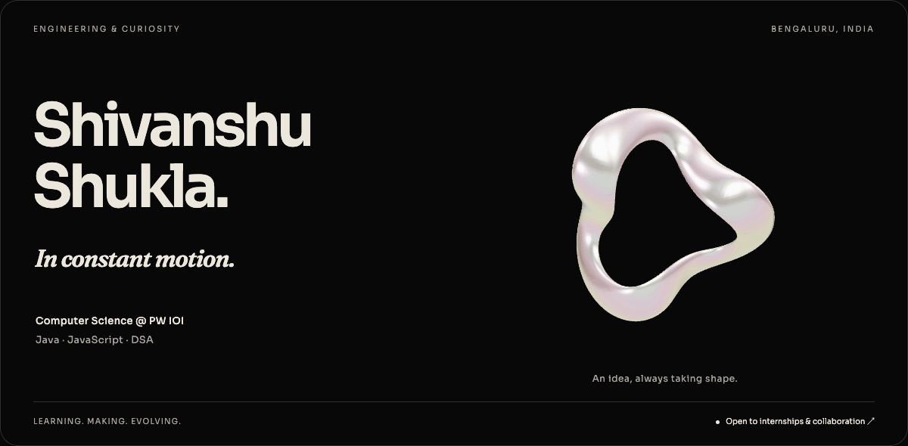
</picture>

  <a href="https://shiv-and-shu-portfolio.vercel.app"><strong>PORTFOLIO ↗</strong></a>
  &nbsp; / &nbsp;
  <a href="https://www.linkedin.com/in/shivanshu-shukla-09a373377/">LINKEDIN ↗</a>
  &nbsp; / &nbsp;
  <a href="mailto:shivanshushukla2602@gmail.com">SAY HELLO ↗</a>
  &nbsp; / &nbsp;
  <a href="https://leetcode.com/u/Shivanshu_19/">PRACTICE ↗</a>

## A little about me

Computer science at **PW IOI, Bengaluru**. Building with **Java and JavaScript**, practising **DSA**, and learning something new with every project.

<picture><source media="(max-width: 767px)" srcset="assets/about-mobile-v8.svg" />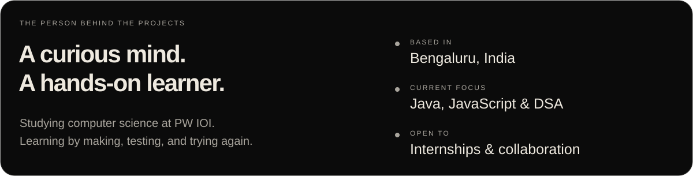</picture>

## Skills & tools

<picture><source media="(max-width: 767px)" srcset="assets/stack-mobile-v8.svg" />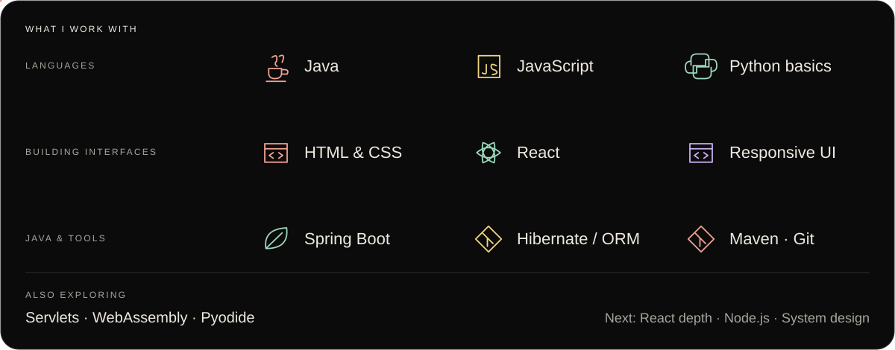</picture>

<strong>Skills at a glance</strong>

| Area | What I work with |
| --- | --- |
| **Languages** | Java · JavaScript · Python foundations |
| **Frontend** | HTML · CSS · JavaScript · React |
| **Java & backend** | Spring Boot · Hibernate · Servlets · ORM |
| **Tools** | Maven · Git · GitHub |
| **Problem solving** | Data structures & algorithms |
| **Browser runtimes** | WebAssembly · Pyodide |
| **Learning next** | Deeper React · Node.js · System design |

## Selected projects

Personal ideas, semester projects, and a buildathon challenge. A few things I’ve put into the world.

<a href="https://github.com/shivanshushukla2602-hash/My-Portfolio">
<picture>
  <source media="(max-width: 767px) and (prefers-reduced-motion: reduce)" srcset="assets/project-portfolio-mobile-v10-static.png" />
  <source media="(prefers-reduced-motion: reduce)" srcset="assets/project-portfolio-v10-static.png" />
  <source media="(max-width: 767px)" srcset="assets/project-portfolio-mobile-v10.gif" />
  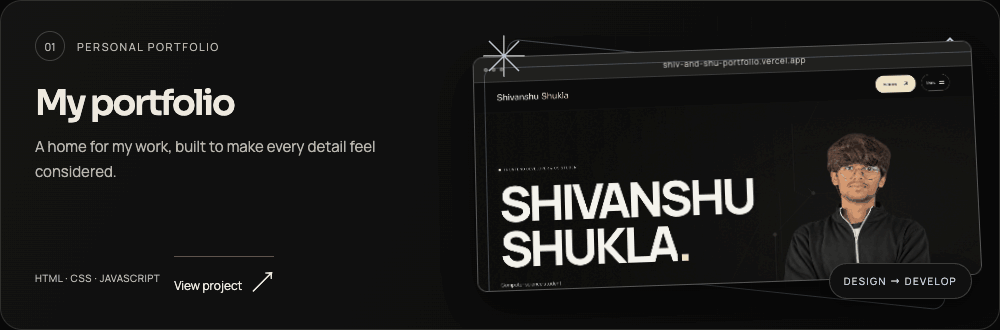
</picture>
</a>

<a href="https://github.com/shivanshushukla2602-hash/PyCosmos">
<picture>
  <source media="(max-width: 767px) and (prefers-reduced-motion: reduce)" srcset="assets/project-pycosmos-mobile-v10-static.png" />
  <source media="(prefers-reduced-motion: reduce)" srcset="assets/project-pycosmos-v10-static.png" />
  <source media="(max-width: 767px)" srcset="assets/project-pycosmos-mobile-v10.gif" />
  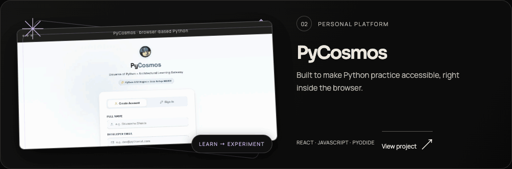
</picture>
</a>

<a href="https://github.com/shivanshushukla2602-hash/SevaRecover">
<picture>
  <source media="(max-width: 767px) and (prefers-reduced-motion: reduce)" srcset="assets/project-sevarecover-mobile-v10-static.png" />
  <source media="(prefers-reduced-motion: reduce)" srcset="assets/project-sevarecover-v10-static.png" />
  <source media="(max-width: 767px)" srcset="assets/project-sevarecover-mobile-v10.gif" />
  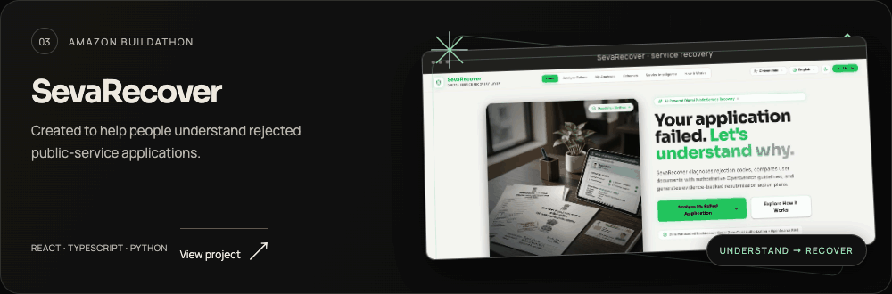
</picture>
</a>

<a href="https://github.com/shivanshushukla2602-hash/InnovateX">
<picture>
  <source media="(max-width: 767px) and (prefers-reduced-motion: reduce)" srcset="assets/project-innovatex-mobile-v10-static.png" />
  <source media="(prefers-reduced-motion: reduce)" srcset="assets/project-innovatex-v10-static.png" />
  <source media="(max-width: 767px)" srcset="assets/project-innovatex-mobile-v10.gif" />
  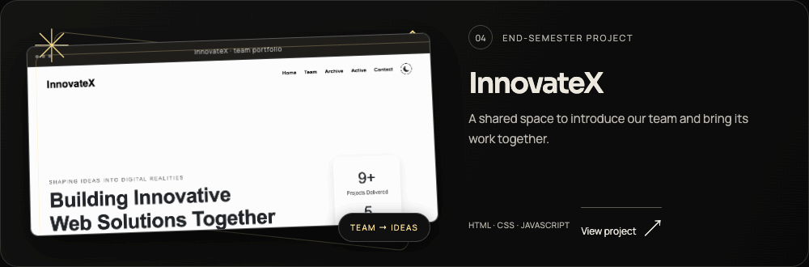
</picture>
</a>

<a href="https://github.com/shivanshushukla2602-hash/SpendWise-old">
<picture>
  <source media="(max-width: 767px) and (prefers-reduced-motion: reduce)" srcset="assets/project-spendwise-mobile-v10-static.png" />
  <source media="(prefers-reduced-motion: reduce)" srcset="assets/project-spendwise-v10-static.png" />
  <source media="(max-width: 767px)" srcset="assets/project-spendwise-mobile-v10.gif" />
  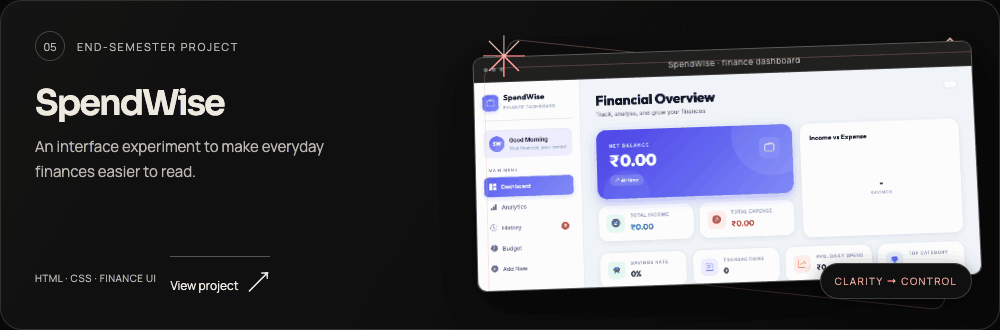
</picture>
</a>

<a href="https://github.com/shivanshushukla2602-hash/Bus-Reservation-System">
<picture>
  <source media="(max-width: 767px) and (prefers-reduced-motion: reduce)" srcset="assets/project-bus-mobile-v10-static.png" />
  <source media="(prefers-reduced-motion: reduce)" srcset="assets/project-bus-v10-static.png" />
  <source media="(max-width: 767px)" srcset="assets/project-bus-mobile-v10.gif" />
  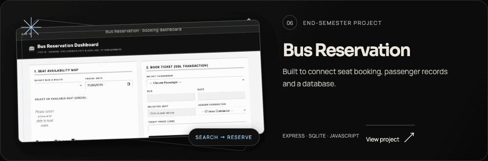
</picture>
</a>

<a href="https://shiv-and-shu-portfolio.vercel.app/#work"><strong>Explore the interactive project gallery ↗</strong></a>

## Problem solving

Data structures, algorithms, and a little more understanding with every problem.

<table>
<tr>
<td width="50%" align="center"><a href="https://leetcode.com/u/Shivanshu_19/">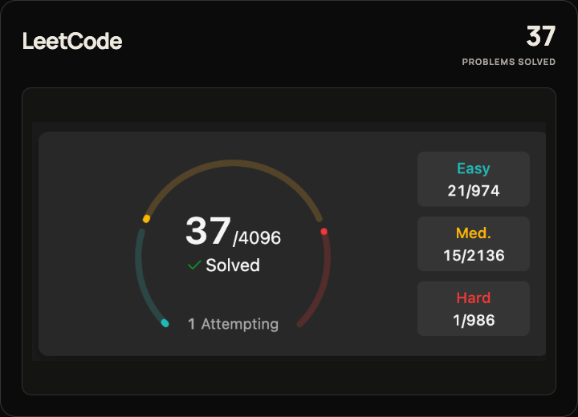</a></td>
<td width="50%" align="center"><a href="https://codeforces.com/profile/shivanshu_19">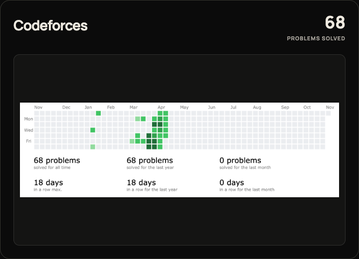</a></td>
</tr>
<tr>
<td width="50%" align="center"><a href="https://www.geeksforgeeks.org/profile/shivanshu19?tab=activity">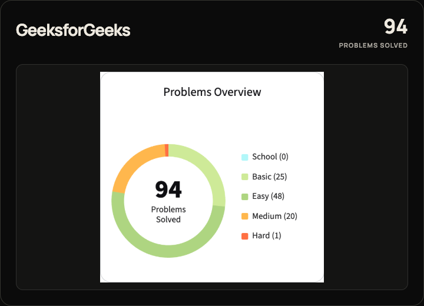</a></td>
<td width="50%" align="center"><a href="https://bruteforce.pwioi.com/profile/shivanshu_19">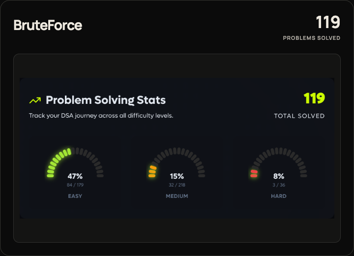</a></td>
</tr>
</table>

Actual platform screenshots: LeetCode and Codeforces supplied by me; GFG and BruteForce captured from my public profiles. Screenshots are snapshots and do not refresh automatically.

<strong>Full profiles, activity and recent solved questions</strong>

<a href="https://www.geeksforgeeks.org/profile/shivanshu19?tab=activity">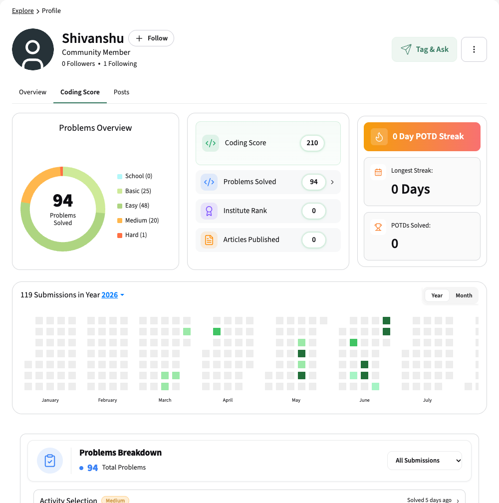</a>

<a href="https://www.geeksforgeeks.org/profile/shivanshu19?tab=activity">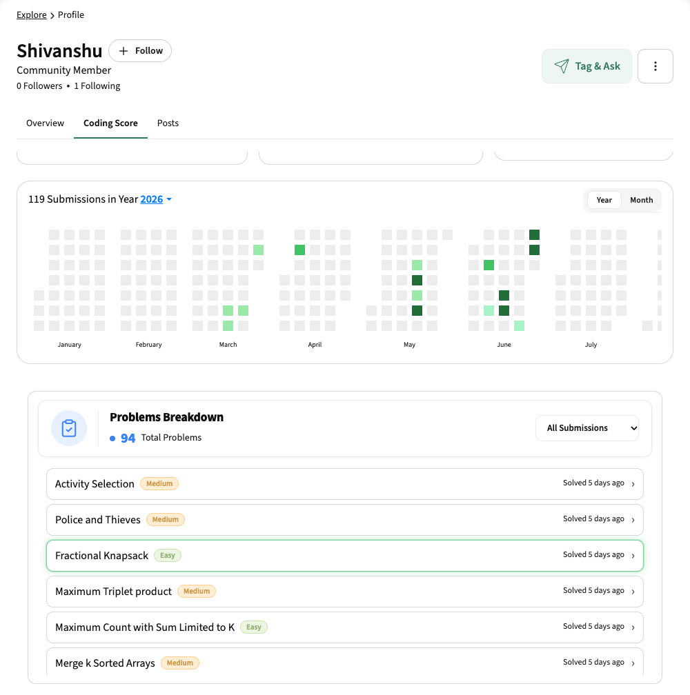</a>

<a href="https://bruteforce.pwioi.com/profile/shivanshu_19">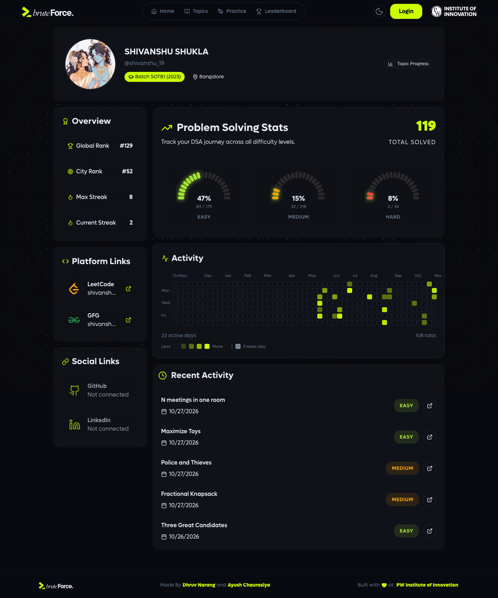</a>

<!-- CODING-STATS:START -->

<strong>View verified statistics</strong>

| Platform | Problems solved | Verified |
| --- | --- | --- |
| [LeetCode](https://leetcode.com/u/Shivanshu_19/) | 43 | 2026-11-04 |
| [Codeforces](https://codeforces.com/profile/shivanshu_19) | 66 | 2026-11-04 |
| [GeeksforGeeks](https://www.geeksforgeeks.org/profile/shivanshu19?tab=activity) | 110 | 2026-11-04 |
| [PW IOI BruteForce](https://bruteforce.pwioi.com/profile/shivanshu_19) | 141 | 2026-11-04 |

<!-- CODING-STATS:END -->

Publicly verified statistics. Counts are kept separate across platforms.

[Browse my public practice code ↗](https://github.com/shivanshushukla2602-hash/Leetcode)

## Consistency, in perspective

<a href="https://github.com/shivanshushukla2602-hash?tab=overview"><picture><source media="(max-width: 767px) and (prefers-reduced-motion: reduce)" srcset="assets/activity-mobile-v9-static.png" /><source media="(prefers-reduced-motion: reduce)" srcset="assets/activity-v9-static.png" /><source media="(max-width: 767px)" srcset="assets/activity-mobile-v9.gif" />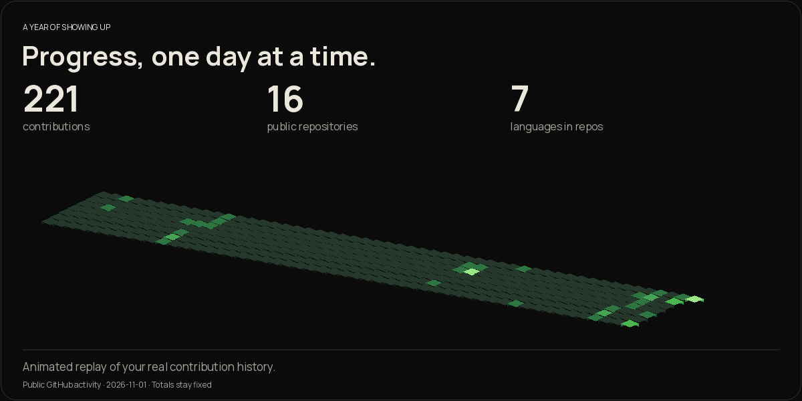</picture></a>

This card refreshes automatically from public GitHub data. Repository languages reflect published code, not a proficiency score.

## Still curious. Still becoming.

<picture>
  <source media="(max-width: 767px) and (prefers-reduced-motion: reduce)" srcset="assets/lab-mobile-v8-static.png" />
  <source media="(prefers-reduced-motion: reduce)" srcset="assets/lab-v8-static.png" />
  <source media="(max-width: 767px)" srcset="assets/lab-mobile-v8.gif" />
  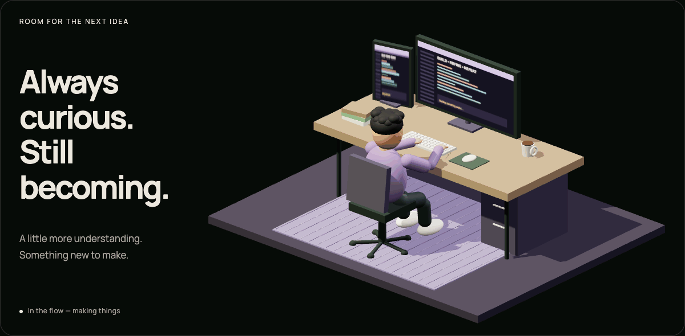
</picture>

**Open to internships and collaborations.** Have something in mind? Let’s talk.

<a href="mailto:shivanshushukla2602@gmail.com"><picture><source media="(max-width: 767px)" srcset="assets/footer-mobile-v8.svg" />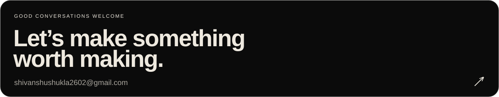</picture></a>

<a href="https://shiv-and-shu-portfolio.vercel.app">Portfolio</a> · <a href="https://www.linkedin.com/in/shivanshu-shukla-09a373377/">LinkedIn</a> · <a href="mailto:shivanshushukla2602@gmail.com">shivanshushukla2602@gmail.com</a>

