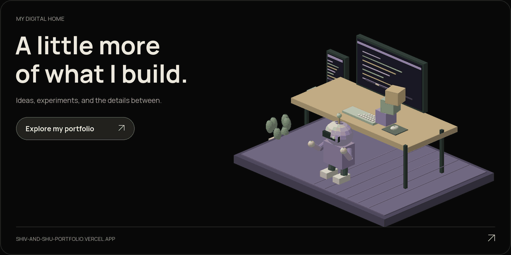
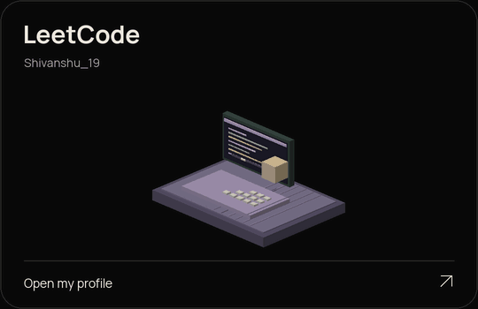
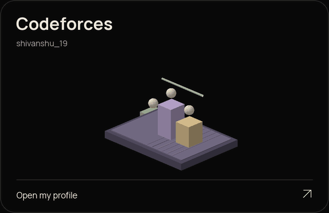
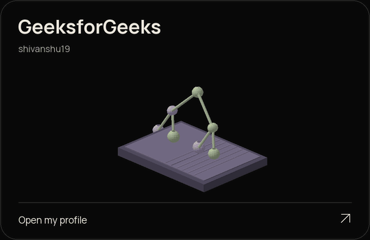
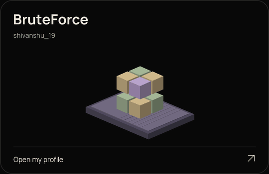
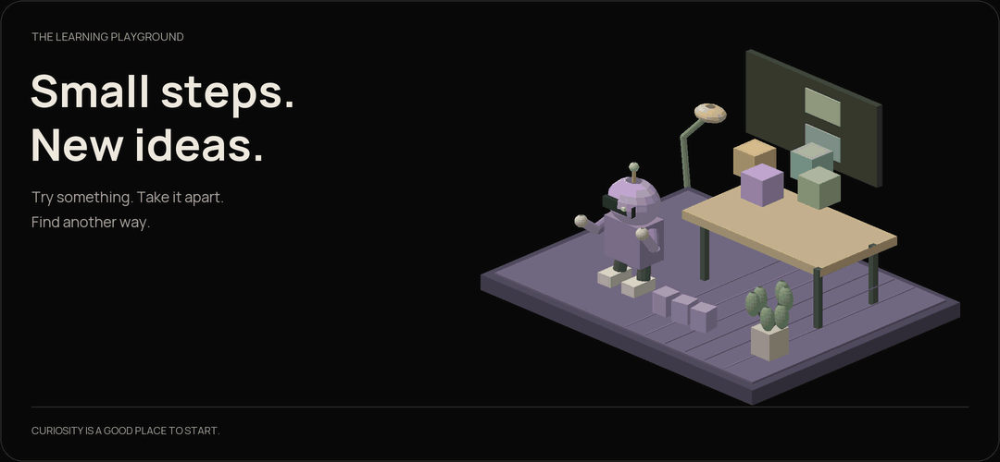

<picture>
  <source media="(max-width: 767px) and (prefers-reduced-motion: reduce)" srcset="assets/header-mobile-v9-static.png" />
  <source media="(prefers-reduced-motion: reduce)" srcset="assets/header-v9-static.png" />
  <source media="(max-width: 767px)" srcset="assets/header-mobile-v9.gif" />
  
</picture>

  <a href="https://shiv-and-shu-portfolio.vercel.app"><strong>PORTFOLIO ↗</strong></a>
  &nbsp; / &nbsp;
  <a href="https://www.linkedin.com/in/shivanshu-shukla-09a373377/">LINKEDIN ↗</a>
  &nbsp; / &nbsp;
  <a href="mailto:shivanshushukla2602@gmail.com">SAY HELLO ↗</a>
  &nbsp; / &nbsp;
  <a href="https://leetcode.com/u/Shivanshu_19/">PRACTICE ↗</a>

## A little about me

Computer science at **PW IOI, Bengaluru**. Building with **Java and JavaScript**, practising **DSA**, and learning something new with every project.

<picture><source media="(max-width: 767px)" srcset="assets/about-mobile-v8.svg" /></picture>

## Skills & tools

<picture><source media="(max-width: 767px)" srcset="assets/stack-mobile-v8.svg" /></picture>

<strong>Skills at a glance</strong>

| Area | What I work with |
| --- | --- |
| **Languages** | Java · JavaScript · Python foundations |
| **Frontend** | HTML · CSS · JavaScript · React |
| **Java & backend** | Spring Boot · Hibernate · Servlets · ORM |
| **Tools** | Maven · Git · GitHub |
| **Problem solving** | Data structures & algorithms |
| **Browser runtimes** | WebAssembly · Pyodide |
| **Learning next** | Deeper React · Node.js · System design |

## Step inside my portfolio

<a href="https://shiv-and-shu-portfolio.vercel.app">
<picture>
  <source media="(max-width: 767px) and (prefers-reduced-motion: reduce)" srcset="assets/portfolio-portal-mobile-v12-static.png" />
  <source media="(prefers-reduced-motion: reduce)" srcset="assets/portfolio-portal-v12-static.png" />
  <source media="(max-width: 767px)" srcset="assets/portfolio-portal-mobile-v12.gif" />
  
</picture>
</a>

## Where I practise

<table>
<tr>
<td width="50%" align="center"><a href="https://leetcode.com/u/Shivanshu_19/">
<picture>
  <source media="(prefers-reduced-motion: reduce)" srcset="assets/practice-leetcode-v12-static.png" />
  
</picture>
 <strong>LeetCode ↗</strong></a></td>
<td width="50%" align="center"><a href="https://codeforces.com/profile/shivanshu_19">
<picture>
  <source media="(prefers-reduced-motion: reduce)" srcset="assets/practice-codeforces-v12-static.png" />
  
</picture>
 <strong>Codeforces ↗</strong></a></td>
</tr>
<tr>
<td width="50%" align="center"><a href="https://www.geeksforgeeks.org/profile/shivanshu19?tab=activity">
<picture>
  <source media="(prefers-reduced-motion: reduce)" srcset="assets/practice-gfg-v12-static.png" />
  
</picture>
 <strong>GeeksforGeeks ↗</strong></a></td>
<td width="50%" align="center"><a href="https://bruteforce.pwioi.com/profile/shivanshu_19">
<picture>
  <source media="(prefers-reduced-motion: reduce)" srcset="assets/practice-bruteforce-v12-static.png" />
  
</picture>
 <strong>BruteForce ↗</strong></a></td>
</tr>
</table>

## A little room to experiment

<picture>
  <source media="(max-width: 767px) and (prefers-reduced-motion: reduce)" srcset="assets/learning-playground-mobile-v12-static.png" />
  <source media="(prefers-reduced-motion: reduce)" srcset="assets/learning-playground-v12-static.png" />
  <source media="(max-width: 767px)" srcset="assets/learning-playground-mobile-v12.gif" />
  
</picture>

## Consistency, in perspective

<a href="https://github.com/shivanshushukla2602-hash?tab=overview"><picture><source media="(max-width: 767px) and (prefers-reduced-motion: reduce)" srcset="assets/activity-mobile-v9-static.png" /><source media="(prefers-reduced-motion: reduce)" srcset="assets/activity-v9-static.png" /><source media="(max-width: 767px)" srcset="assets/activity-mobile-v9.gif" /></picture></a>

This card refreshes automatically from public GitHub data. Repository languages reflect published code, not a proficiency score.

## Still curious. Still becoming.

<picture>
  <source media="(max-width: 767px) and (prefers-reduced-motion: reduce)" srcset="assets/lab-mobile-v8-static.png" />
  <source media="(prefers-reduced-motion: reduce)" srcset="assets/lab-v8-static.png" />
  <source media="(max-width: 767px)" srcset="assets/lab-mobile-v8.gif" />
  
</picture>

**Open to internships and collaborations.** Have something in mind? Let’s talk.

<a href="mailto:shivanshushukla2602@gmail.com"><picture><source media="(max-width: 767px)" srcset="assets/footer-mobile-v8.svg" /></picture></a>

<a href="https://shiv-and-shu-portfolio.vercel.app">Portfolio</a> · <a href="https://www.linkedin.com/in/shivanshu-shukla-09a373377/">LinkedIn</a> · <a href="mailto:shivanshushukla2602@gmail.com">shivanshushukla2602@gmail.com</a>

